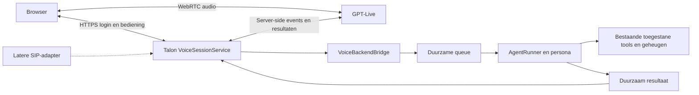

# Browservoice design

## Components

Browser/WebRTC, VoiceSessionService, LiveVoiceProvider, VoiceBackendBridge en duurzame voice-opslag. GPT-Live verzorgt het gesprek; Talon bezit uitvoering en autorisatie. De onderstaande oorspronkelijke ontwerptekst is inhoudelijk leidend, met alleen de administratieve status geactualiseerd.

## Interfaces

TASK-01 bevriest VoiceTransport, provider-events, VoiceStore-transacties, policy-snapshots, HTTP/status DTOs en backendrequest/resultaat. Geen browser- of modelinput kiest toolrechten. De overige taken gebruiken diezelfde contracten.

## Integration surfaces

- `src/voice/voice-types.ts` — owned by: TASK-01-contracts
- `.wdd/epics/browservoice/evidence/**` — owned by: TASK-01-contracts
- `src/voice/voice-store.ts` — owned by: TASK-02-persistence
- `src/core/database/repositories/voice-repository.ts` — owned by: TASK-02-persistence
- `src/core/database/repositories/index.ts` — owned by: TASK-02-persistence
- `src/core/database/migrations/*-voice-*.sql` — owned by: TASK-02-persistence
- `tests/unit/core/database/voice/**` — owned by: TASK-02-persistence
- `src/voice/transports/browser/**` — owned by: TASK-03-browser-server
- `src/voice/voice-auth.ts` — owned by: TASK-03-browser-server
- `tests/unit/voice/browser-server/**` — owned by: TASK-03-browser-server
- `tests/unit/voice/browser-server/voice-auth.test.ts` — owned by: TASK-03-browser-server
- `src/voice/providers/**` — owned by: TASK-04-live-adapter
- `tests/unit/voice/providers/**` — owned by: TASK-04-live-adapter
- `src/voice/voice-backend-bridge.ts` — owned by: TASK-05-backend
- `src/voice/voice-output-sink.ts` — owned by: TASK-05-backend
- `src/daemon/agent-runner.ts` — owned by: TASK-05-backend
- `src/daemon/context-assembler.ts` — owned by: TASK-05-backend
- `src/queue/queue-manager.ts` — owned by: TASK-05-backend
- `src/queue/queue-processor.ts` — owned by: TASK-05-backend
- `src/queue/queue-types.ts` — owned by: TASK-05-backend
- `src/core/database/repositories/queue-repository.ts` — owned by: TASK-05-backend
- `src/core/database/repositories/voice-repository.ts` — owned by: TASK-05-backend
- `src/channels/channel-types.ts` — owned by: TASK-05-backend
- `tests/unit/voice/backend/**` — owned by: TASK-05-backend
- `tests/unit/daemon/agent-runner*.test.ts` — owned by: TASK-05-backend
- `tests/unit/daemon/context-assembler*.test.ts` — owned by: TASK-05-backend
- `tests/unit/queue/**` — owned by: TASK-05-backend
- `src/voice/voice-session-service.ts` — owned by: TASK-06-lifecycle
- `src/voice/voice-session-reconciler.ts` — owned by: TASK-06-lifecycle
- `src/voice/voice-policy.ts` — owned by: TASK-06-lifecycle
- `src/daemon/daemon-bootstrap.ts` — owned by: TASK-06-lifecycle
- `src/daemon/daemon-context.ts` — owned by: TASK-06-lifecycle
- `src/daemon/daemon.ts` — owned by: TASK-06-lifecycle
- `src/core/config/config-schema.ts` — owned by: TASK-06-lifecycle
- `src/core/config/config-types.ts` — owned by: TASK-06-lifecycle
- `src/channels/channel-setup.ts` — owned by: TASK-06-lifecycle
- `src/daemon/channel-factory.ts` — owned by: TASK-06-lifecycle
- `tests/unit/voice/lifecycle/**` — owned by: TASK-06-lifecycle
- `tests/unit/voice/lifecycle/policy.test.ts` — owned by: TASK-06-lifecycle
- `tests/unit/daemon/daemon*.test.ts` — owned by: TASK-06-lifecycle
- `tests/unit/core/config/**` — owned by: TASK-06-lifecycle
- `src/voice/web/**` — owned by: TASK-07-browser-ui
- `package.json` — owned by: TASK-07-browser-ui
- `tests/unit/voice/browser-client/**` — owned by: TASK-07-browser-ui
- `tests/integration/voice/**` — owned by: TASK-08-validation-docs
- `README.md` — owned by: TASK-08-validation-docs
- `AGENTS.md` — owned by: TASK-08-validation-docs
- `config/talond.example.yaml` — owned by: TASK-08-validation-docs
- `docs/guides/voice.mdx` — owned by: TASK-08-validation-docs
- `docs/reference/config-schema.mdx` — owned by: TASK-08-validation-docs
- `.agents/skills/talon-setup/**` — owned by: TASK-08-validation-docs
- `.agents/skills/talon-setup-docker/**` — owned by: TASK-08-validation-docs
- `.agents/skills/add-voice/**` — owned by: TASK-08-validation-docs
- `.wdd/epics/browservoice/evidence/**` — owned by: TASK-08-validation-docs

## Epic deliverable

Een werkende, opt-in browservoice-integratie met Talon en de negen criteria uit spec.md. Het finale automatische bewijs is `npm run lint && npx tsc --noEmit && npx vitest run tests/integration/voice && npm run build`. Ivo heeft de gerichte unit- en integratietestwijzigingen uit dit plan toegestaan. Gerichte unitregressies en de apart geautoriseerde live browserproef blijven bovendien vereist; dit commando alleen bewijst geen Nederlandse gesprekskwaliteit.

## Detailed design

# Browservoice voor Talon — eerste versie

Ontwerp uit de besproken planning van 11 oktober 2026. Uitvoering is gestart via WDD.
Broncodebasis: `0bf45cf332a0644fb3a13f2ad99d60102c5be972`.

## Doel en afbakening

Ivo opent een beveiligde pagina op telefoon of desktop, start een gesprek en spreekt met GPT-Live. Talon behandelt opdrachten met een expliciet voor voice ingestelde persona. Later kan dezelfde gespreksbeheerder een SIP-adapter krijgen. Zelf bellen is V1; gebeld worden door Talon is een volgende iteratie.

V1 bevat starten, microfoon dempen, ophangen, verbindingsstatus, zichtbare taakstatus en een indicatie van voicekosten. Geen SIP, telefoonnummer, inkomende belmelding, groepsgesprek, video, achtergrondwerking bij een vergrendelde telefoon of naadloos hervatten van de audioverbinding. De pagina blijft tijdens het gesprek geopend. Een verbroken gesprek kan een nieuwe sessie starten; lopende opdrachten worden niet automatisch herhaald.

## Voorgestelde keuzes

Dit zijn concrete ontwerpvoorstellen, geen reeds goedgekeurde productpolicy:

- Eén operator, één ingestelde voice-persona en maximaal één gesprek tegelijk per daemon.
- Marin (`marin`) is de door Ivo gekozen standaardstem. De GPT-Live-adapter zet bij sessiecreatie expliciet `audio.output.voice: "marin"`, zodat Talon niet afhankelijk is van een veranderende providerdefault.
- Voice staat standaard uit. Een afzonderlijke luisterpoort bindt standaard aan loopback; voor een telefoon is een bestaande HTTPS reverse proxy of private netwerkroute nodig. Geen automatische tunnel of publieke deployment.
- Een expliciet geconfigureerd voice-toegangstoken wordt via een loginformulier ingewisseld voor een kortlevende HttpOnly, SameSite=Strict cookie. Secure bij HTTPS; localhost is de enige ontwikkeluitzondering. Geen tokens in URL, localStorage of logregels. Logout trekt de login in en sluit bijbehorende gesprekken.
- Vijftien minuten maximale gespreksduur als instelbaar V1-voorstel. De server bewaakt dit, ook wanneer de browser verdwijnt. Sessies hebben tevens een eindige setup- en afsluitdeadline.
- Een nieuw Talon-thread per gesprek. Binnen het gesprek behouden delegaties context. Bestaand expliciet beschikbaar persona-/toolgeheugen blijft bruikbaar; automatisch samenvoegen met Telegram- of andere privéthreads valt buiten V1.
- Geen ruwe audio-opslag door Talon. Transcriptfragmenten blijven tijdelijk in geheugen; alleen benodigde opdrachtscontext, resultaten en technische sessie-/delegatiemetadata worden duurzaam bewaard volgens Talons bestaande opslagbeleid. Dit is geen belofte over OpenAI-retentie: die instelling moet bij ingebruikname apart worden gecontroleerd en gedocumenteerd.
- Geen algemene approval-engine toevoegen. Een voice-persona met effectieve `requireApproval`-rechten wordt geweigerd. Ook impliciete native provider-tools en onbegrensde MCP-toegang mogen deze beperking niet omzeilen: de eerste ondersteunde backendconfiguratie moet aantoonbaar alleen de bedoelde tools ontsluiten.

## Architectuur

De audiostroom gaat rechtstreeks tussen browser en OpenAI. Talon bezit authenticatie, persona-keuze, taaktoelating, opslag en de server-side verbinding met GPT-Live. Browservelden, transcripttekst en modeluitvoer bepalen nooit rechten of een willekeurige persona. Een modelbericht kan uitsluitend een voorstel voor werk zijn.

`VoiceTransport` verzorgt verbinding openen/sluiten en transportstatus. `LiveVoiceProvider` vertaalt GPT-Live-events. `VoiceSessionService` bezit de gesprekstoestand. `VoiceBackendBridge` vertaalt een gevalideerde delegatie naar bestaand Talon-werk. Alleen deze kleine grenzen zijn nodig; geen generiek nieuw agentframework.

Een latere `SipTransport` levert dezelfde identiteit/sessie-interface na eigen authenticatie. SIP-headers en caller ID zijn geen bewijs van bevoegdheid. SIP voegt webhooks, nummerbeheer, call routing en eventueel uitgaande autorisatie toe; die logica komt niet in AgentRunner of de browser.

## Gecontroleerde beperkingen in de huidige code

- `src/channels/channel-types.ts`: `AgentOutput` heeft geen onderscheid tussen voortgang en eindresultaat. `send()` is een aflevercontract, geen voltooiingssignaal.
- `src/pipeline/message-pipeline.ts`: normaliseert/persisteert tekst en bouwt een vaste queuepayload. Willekeurige `raw`-metadata is geen betrouwbare manier om delegatiecontext door te geven.
- `src/queue/queue-manager.ts`: kiest momenteel één algemene `maxAttempts`. Voice heeft een expliciete uitvoeringspolicy nodig.
- `src/daemon/agent-runner.ts`: levert tussentekst, toolmeldingen en eindtekst via dezelfde connector; afleverfouten kunnen uitvoeringsfouten worden. De nieuwe resultaatsgrens moet uitvoering losmaken van audioaflevering.
- `src/tools/tool-filter.ts`: `requireApproval` maakt tools momenteel beschikbaar, maar implementeert geen uitvoeringsbevestiging. Niet doen alsof voice dit al erft.
- Er is geen bewezen publieke annuleerinterface voor een afzonderlijke AgentRunner-taak. V1 mag geen succesvolle annulering suggereren.

## API- en contextcontract

Voorgestelde app-routes: login/logout, `POST /voice/sessions`, `GET /voice/sessions/:id`, `POST /voice/sessions/:id/close` en een geauthenticeerde statusstream. Iedere route controleert eigenaar, origin en sessieverval; mutaties krijgen CSRF-bescherming. Instelbare limieten begrenzen loginpogingen, sessiecreatie, SDP, events, transcriptbuffer en uitgaande resultaten. De browser ontvangt alleen de noodzakelijke SDP/sessiongegevens en geredigeerde status.

De server configureert GPT-Live met client delegation. Een delegatie-event bevat een ID en tijdpositie, niet de opdrachttekst. Daarom houdt de server een geordende transcriptbuffer bij en koppelt een begrensde momentopname aan elke delegatie. Late fragmenten, dubbele events en correcties worden expliciet verwerkt. Bij ontbrekende of dubbelzinnige context wordt om verduidelijking gevraagd; er wordt geen lege of gegokte opdracht uitgevoerd.

De minimale interne records zijn:

- `VoiceSession`: eigen ID, provider-session-ID, geauthenticeerde eigenaar, persona, thread, transport, status, begintijd/deadline, laatst bevestigde gebruiksduur en finalisatiestatus.
- `VoiceDelegation`: unieke combinatie van sessie en provider-delegatie-ID, contextversie, queue-/run-ID, uitvoeringsstatus, begrensd resultaat en aparte afleverstatus.
- `VoiceBackendRequest`: uitsluitend door de server gemaakte verwijzingen plus opdrachtscontext; geen browsergestuurde tools, credentials of providerkeuze.
- `VoiceBackendResult`: voortgang, resultaat of fout; geen ruwe modelredenering, tooltrace of vertrouwelijke backendconfiguratie.

Alle modulegrenzen gebruiken het bestaande `Result`-patroon. De provideradapter is de enige plek met OpenAI-eventnamen. Transcriptfragmenten zijn onbetrouwbare gebruikersdata. Resultaten worden pas als voltooid aangeboden na bevestiging vanuit Talon; een provider-ack betekent niet dat de gebruiker het antwoord gehoord heeft.

## Uitvoering, onderbrekingen en herstel

Gebruik de bestaande queue en AgentRunner voor backendwerk; geen tweede agentrunner. Voeg een smalle, getypeerde voice-uitvoeringscontext en resultaatsafhandeling toe. Bestaande tekstkanalen blijven op hun huidige pad. Reuse van provider-sessies blijft beperkt tot het gesprek en de bestaande provider/model/reasoning-identiteit.

Per gesprek is maximaal één delegatie actief. Nieuwe correcties krijgen een contextversie. Een nog niet gestarte opdracht kan transactioneel worden vervangen: een compare-and-set laat alleen een nog niet geclaimde delegatie superseden. Bewaar de oorspronkelijke ID/contextdigest onveranderd; de vervanging krijgt een nieuwe revisie/ID. Als claimen wint, geldt de opdracht als lopend. Een lopende opdracht krijgt geen schijnbare live steering als de provider dit niet ondersteunt. Bij wijzigingen tijdens een uitvoering meldt de UI dat deze al loopt en vraagt de backend zo nodig om verduidelijking voor vervolgwerk. Verouderde resultaten mogen niet als antwoord op een gewijzigde opdracht worden uitgesproken.

Over iemand heen praten stopt of verandert de spraak, niet automatisch de taak. Ophangen weigert nieuwe delegaties en laat al gestart werk begrensd afronden volgens de bestaande provider-timeout. Nog niet gestarte voice-opdrachten worden overgeslagen. Resultaten blijven raadpleegbaar in de geauthenticeerde pagina. V1 biedt geen knop die beweert reeds uitgevoerde externe handelingen terug te draaien.

Een durable delegatierecord wordt vóór queue-admissie gereserveerd. De koppeling met queuewerk moet transactioneel of aantoonbaar herstelbaar zijn. Dubbele provider-events leveren dezelfde delegatie op. Uitvoering wordt niet opnieuw gestart wegens een bezorgfout, reconnect of browserrefresh. Voice krijgt geen automatische retry of providerfailover die een mogelijk uitgevoerde actie opnieuw kan uitvoeren. Controleer daarbij ook startup-recovery en handmatige dead-letter replay: `maxAttempts=1` alleen bewijst dit niet.

Na een crash kan een begonnen opdracht een onbekende uitkomst hebben. Markeer die als onbekend, controleer bewaarde resultaten en vraag zo nodig om beoordeling. Beloof geen exactly-once effecten bij externe tools. Een aparte afleverpoging mag een bewaard resultaat gebruiken, maar nooit de oorspronkelijke agentopdracht opnieuw draaien. Ook afleveren heeft begrensde retries; onduidelijke acks worden niet blind als hoorbare herhalingen behandeld.

## Beveiliging en beheer

Geen OpenAI-projectsleutel naar de browser. Geen tools direct via de browser-eventstream. De server-side verbinding is de bron voor delegaties; door de browser nagebootste provider-events worden niet aangenomen. Verifieer in de eerste proef welke sessieconfiguratie een WebRTC-client kan wijzigen: eventuele clientmutaties mogen geen extra tools, kostenmodellen of backendrechten ontsluiten. Als dat niet aantoonbaar kan worden begrensd, herzie de transportkeuze vóór implementatie van de rest.

Native provider-tools en geconfigureerde MCP-servers moeten in de voice-toelating worden meegenomen. Kies een bewezen beperkte backendconfiguratie; claim geen OS-isolatie. Controleer de effectieve configuratie opnieuw bij opdrachttoelating, niet alleen bij daemonstart. Een ingetrokken login of uitgeschakelde persona krijgt geen nieuw werk. Bewaar bij toelating de effectieve policy/configuratiegeneratie en controleer die opnieuw direct vóór provideruitvoering: reeds ingepland werk wordt geweigerd als login, persona, capabilities, native tools of MCP-configuratie intussen zijn gewijzigd of ingetrokken. Hiermee blijft een wachtrij geen achterdeur naar oude rechten.

Audit alleen sessie-/taak-ID's, statusovergangen, weigeringen en gebruiksmetadata. Geen ruwe SDP, API-responses met credentials, audio, transcript of toolinhoud in gewone logs. De pagina rendert transcript en resultaten als tekst, niet als willekeurige HTML. Buffer- en sessielimieten zijn server-side afdwingbaar en worden getest.

Voicekosten en backendkosten blijven aparte velden. Providergebruik is cumulatief; tel updates niet bij elkaar op. Toon lopende kosten als schatting en eindkosten alleen als bevestigd wanneer de afsluitinformatie aanwezig is. De WebRTC-initialisatie kan volgens de huidige docs 15 seconden verbruik reserveren, verrekend zodra de sessie loopt; neem mislukte startups dus mee. De prijs is configuratie/documentatie, geen hardcoded contract.

## Acceptatiecriteria

### AC-01 — Toegang
Zonder geldige login ontstaat geen betaalde sessie of backendwerk. Verlopen/ingetrokken login, verkeerde origin en een sessie van een andere eigenaar worden geweigerd. De API-sleutel is niet zichtbaar in browsercode, netwerkpayloads naar de browser of logs.

### AC-02 — Gesprek
Start, dempen en ophangen werken op desktop Chrome en Safari op een iPhone via HTTPS. Microfoonweigering, autoplayblokkade en netwerkverlies hebben begrijpelijke herstelmeldingen; audio en microfoon worden opgeruimd. Achtergrond-/lockscreenwerking wordt niet beloofd.

### AC-03 — Talon-backend
Een gesproken verzoek voert een vooraf toegestane Talon-tool uit en het geverifieerde resultaat wordt uitgesproken. De server kiest persona en toolrechten. Transcriptcorrecties en korte vervolgantwoorden worden met gesprekcontext geïnterpreteerd. Onduidelijke opdrachttekst leidt tot verduidelijking.

### AC-04 — Rechten
Effectieve `requireApproval`-configuratie wordt geweigerd. Niet-toegestane hosttools, native tools en MCP-routes zijn niet bereikbaar vanuit de gekozen V1-backendconfiguratie. Gewijzigde browser-events verruimen de autorisatie niet. Een policywijziging tussen enqueue en uitvoering blokkeert de oude opdracht vóór enige toolactie.

### AC-05 — Geen automatische heruitvoering
Dubbele delegaties, crash na een toolactie, uitgevallen aflevering, reconnect en herstel van de queue veroorzaken geen automatische tweede uitvoering. Onbekende uitkomsten worden zichtbaar als onbekend. Bestaande tekstkanaal-retrytests blijven slagen.

### AC-06 — Levenscyclus
Onderbreken stopt spraak zonder valse taakannulering. Ophangen voorkomt nieuw werk, bewaart het resultaat van reeds gestart werk en ruimt sessies op. Serverdeadline werkt zonder browser. Provider-ack, afgeronde uitvoering en daadwerkelijk afgespeelde audio zijn onderscheiden toestanden.

### AC-07 — Data en kosten
Geen ruwe audio-opslag; alleen benodigde tekst wordt bewaard. Cumulatieve gebruiksupdates worden correct verwerkt. Ontbrekende finalisatie levert een onvolledige kostenstatus op. Opslag, cloudverwerking en retentie zijn gedocumenteerd.

### AC-08 — SIP-uitbreidbaarheid
Een fake tweede transportadapter kan dezelfde sessie- en backendcontracten gebruiken zonder wijziging van AgentRunner of browsercode. Geen echte SIP-aansluiting nodig voor V1.

### AC-09 — Releasebewijs
Lint/typecheck, gerichte tests en build slagen. Browsercontrole en een expliciet toegestane live Nederlandse proef tonen een kort gesprek, tooltaak, interruptie en hangup. Rapporteer gemeten verbindings- en antwoordvertraging en door Ivo beoordeelde gesprekskwaliteit, geen onbewezen latencygarantie. README, configuratiegids en relevante setup-skills beschrijven de daadwerkelijke beperkingen.

## Bouwvolgorde en beslismoment

1. Contracten en een beperkte live haalbaarheidsproef. Bewijs transcript/delegatie-koppeling, sideband-events, clientmutaties en afsluiten. Stop als de providercontracten onvoldoende zijn; niet stilzwijgend vervangen door een ander product.
2. Duurzame sessies/delegaties, server-authenticatie en een geïsoleerde GPT-Live-adapter.
3. De backendbrug met veilige uitvoerings-/aflevergrenzen; daarna lifecycle en daemonregistratie.
4. Een kleine browserpagina, integratiecontrole en documentatie.

Zie `plan.json` en `tasks/` voor concrete eigenaarschapgrenzen. Ivo heeft uitvoering en de gerichte testwijzigingen toegestaan. Service-starts en toegang tot credentials vereisen afzonderlijke autorisatie; de begrensde voiceproeven zijn apart toegestaan. Gereviewde en geverifieerde taakbranches mogen via WDD lokaal in epic/browservoice worden geïntegreerd. Push en merge naar main zijn uitgesloten.

De WDD-controller is geïnitialiseerd en de goedgekeurde configuratie is geratificeerd. Deze planning staat in de controller-aangemaakte namespace browservoice. Implementatie gebruikt GPT-5.6 Luna / max; PR-werk en WDD-reviews gebruiken GPT-6.1 Sol / xhigh. Er is geen verplichte review vóór iedere commit.

## Bronnen

Officiële API-documentatie gecontroleerd op 11 oktober 2026; opnieuw controleren bij implementatie:

- [GPT-Live: backendkeuze](https://developers.openai.com/api/docs/guides/live)
- [Client delegation en transcriptcontext](https://developers.openai.com/api/docs/guides/live-delegation)
- [WebRTC-handshake en initialisatie](https://developers.openai.com/api/docs/guides/voice-webrtc)
- [Sessies en afsluiting](https://developers.openai.com/api/docs/guides/live-conversations)
- [Latere SIP-koppeling](https://developers.openai.com/api/docs/guides/voice-sip)
